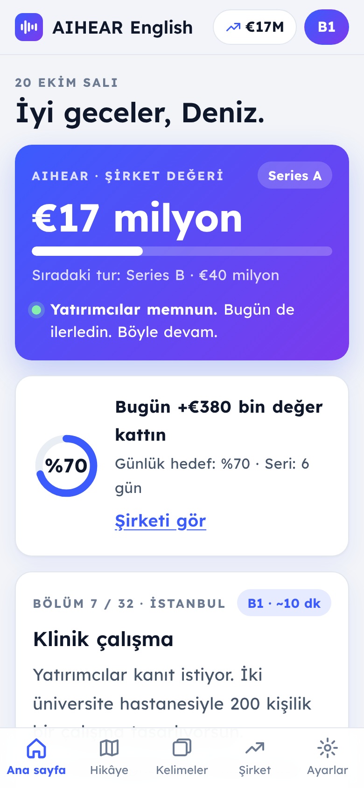

# AIHEAR English

İngilizceyi kendi işinle öğren. Girişimciler için, disleksi dostu bir İngilizce uygulaması.
Yatırımcı sunumu, ürün demosu, sertifikasyon, ekip yönetimi ve yurt dışında hayat.
**Her ders A1'den C2'ye altı seviyede yazıldı:** aynı hikâye, senin seviyende.



## Özellikler

- **Kurucunun hikâyesi.** 32 ders tek bir hikâyede: İstanbul'da prototip, klinik çalışma, Londra'da konferans, Berlin'e taşınma, ilk müşteriler ve yatırım turu. 6 sezon, 32 bölüm. Her bölüm bir sonrakinin kilidini açar; ilerleme bir yol haritasında görünür. Aynı karakterler geri gelir: Sarah, Dr. Weber, ev sahibi Bayan Becker, komşu Lena. (Ayarlar'dan kilitler kapatılabilir.)
- **Puan yerine şirket değeri.** AIHEAR €100 bin değerle başlar, her ders, oyun ve tekrar değeri artırır. Rozetler yerine yatırım turları açılır: Pre-seed, Seed, Series A, Series B, halka arz, unicorn. Çalışmadığın günlerde değer düşmez; sadece yatırımcılar endişelenir.
- **Okumadan oynanan kelime oyunları.** “Dinle ve seç”, sesleri anlamlarla “Eşleştir” ve “60 saniye” hızlı turu. Kaçırılan kelimeler tekrar listesinde öne geçer.
- **Yatırımcı düellosu.** Sarah'yla 6 soruluk süreli pitch turu. Her ikna edici cevapta soru bir seviye zorlaşır; sonunda yatırım teklifi ya da “şimdilik hayır”.
- **Telaffuz karaokesi.** Cümleyi sesli oku; doğru söylenen kelimeler yeşil, eksikler kırmızı olur. Kısaltmalar ve sayılar doğru eşleşir. (Chrome ve Android; iPhone Safari konuşma tanımayı desteklemiyor.)
- **Her ders altı seviyede (A1–C2).** 32 × 6 = 192 metin. Seviye düğmesiyle tüm uygulama değişir; zor gelen metni “Daha kolay” ile bir alt seviyede okursun. Seviye testi ve başarıya göre seviye önerisi var.
- **Her derste 5 adım:** metin, kelimeler ve dil yapısı, anlama, kullanım, konuşma simülasyonu.
- **Disleksi için tasarlandı.** Lexend ve Atkinson Hyperlegible, büyük yazı ve geniş aralık seçenekleri, yumuşak zeminler, kartta tek cümle, sesli okurken kelime vurgulama, odak modu, harf yer değiştirmesini kabul eden kontrol, yazmak yerine seçerek cevaplama.
- **Aralıklı tekrar**, **isteğe bağlı canlı yapay zekâ** (Anthropic API anahtarıyla), **çevrimdışı çalışma** ve **gizlilik**: hesap yok, sunucu yok, her şey cihazda.

## Yayınlama (GitHub Pages)

1. Bu dalı `main` ile birleştir.
2. GitHub'da **Settings → Pages → Source: GitHub Actions** seç.
3. `main`'e her gönderimde `.github/workflows/pages.yml` içeriği doğrular ve yalnızca uygulama dosyalarını yayınlar.
4. Adres: `https://<kullanıcı-adı>.github.io/<depo-adı>/`

Telefona kurulum:

- **iPhone (Safari):** adresi aç → Paylaş → **Ana Ekrana Ekle**.
- **Android (Chrome):** adresi aç → menü → **Uygulamayı yükle**.

Uygulama mağazaları için: yayınlanan adresi [PWABuilder](https://www.pwabuilder.com) ile Google Play (TWA) ve App Store paketine dönüştürebilirsin. Manifest, ikonlar (maskable dahil), ekran görüntüleri ve gizlilik politikası hazır.

## Geliştirme

Derleme adımı yok; düz HTML, CSS ve JavaScript. Node 20+ sadece araçlar ve testler için gerekir.

```bash
npm install                      # Playwright (testler için)
npx playwright install chromium  # bir kez
npm run serve                    # http://localhost:8080
npm run check                    # dersleri doğrula, paketler güncel mi kontrol et
npm test                         # tarayıcıda uçtan uca testler
```

Diğer komutlar:

```bash
npm run build                          # content/src → content/catalog.js + content/levels/*.js
npm run icons                          # ikonları yeniden üret
node tools/screenshots.mjs             # mağaza ekran görüntüleri ve icons/og.png
node tools/build-single.mjs out.html   # tek dosyalık sürüm (tüm seviyeler gömülü)
```

## İçerik

Her ders `content/src/<id>.json` dosyasında, altı seviyesiyle birlikte durur. Yazım kuralları, seviye hedefleri ve tüm derslerde tutarlı kalması gereken bilgiler [docs/CONTENT_GUIDE.md](docs/CONTENT_GUIDE.md) içinde.

Yeni ders eklemek için:

1. `content/src/<id>.json` dosyasını rehbere göre yaz. Öğrencinin adı için `{name}` kullan.
2. Kimliği `content/curriculum.json` içindeki `order` listesine ve `content/story.js` içine (aynı sırada, bir sezona bağlı, başlık ve hikâye metniyle) ekle.
3. `npm run validate` ile hataları düzelt, sonra `npm run build`.

`tools/validate.mjs` her seviye için cümle uzunluğunu, kelime ve soru sayılarını, cevap indekslerini, boşluk ve çeviri anahtarlarını kontrol eder. CI, doğrulama ve testler geçmeden yayınlamaz.

## Dosyalar

```
index.html, privacy.html, manifest.json, sw.js   uygulama kabuğu, gizlilik, PWA
css/app.css                                      tasarım ve okunabilirlik ayarları
js/app.js                                        uygulama (yönlendirme, dersler, tekrar, ses, ayarlar)
content/src/*.json                               ders kaynakları (düzenlenen dosyalar)
content/catalog.js, content/levels/*.js          derlenmiş içerik (elle düzenleme)
content/placement.js                             seviye testi soruları
content/story.js                                 kurucunun hikâyesi: sezonlar, bölüm metinleri, karakterler
tools/                                           doğrulama, derleme, ikon ve ekran görüntüsü araçları
tests/e2e.mjs                                    uçtan uca testler
docs/CONTENT_GUIDE.md                            içerik yazım rehberi
```
